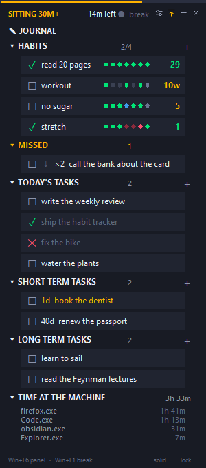
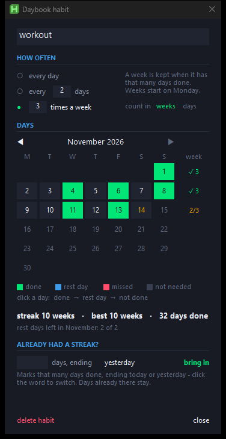
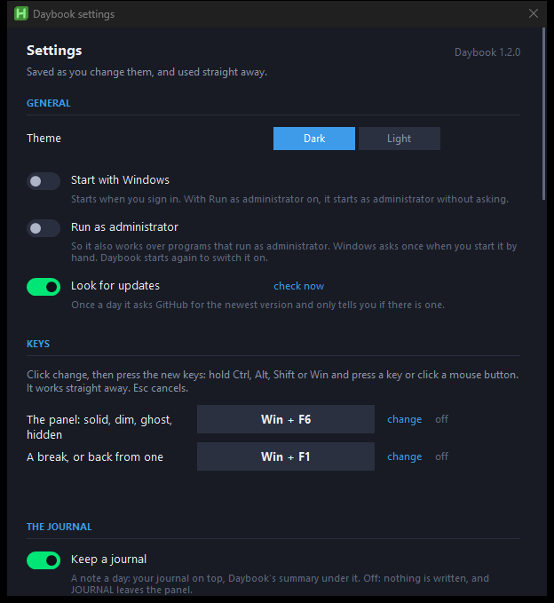

# Semi-Automatic Daybook

**A small day panel for Windows: a habit tracker with streaks, a to-do list,
a sit timer that only counts time at the desk, and a plain markdown journal -
one file a day, ready for Obsidian.**

Semi-automatic: it keeps the half of a journal that is counting, and leaves the
half that is thinking to you.

AutoHotkey v2 · Windows 10 and 11 · no account, no tracking



## How to use it

**Habits.** A tick box, a week of dots and a streak. **Every dot is a button** -
click Tuesday's and Tuesday is ticked, for the evening you did the thing and
forgot to say so. Every day, every few days, or so many times a week. Click a
done dot again and it turns blue: a rest day, for when you are sick or away.
Right-click a habit for its calendar.

<details>
<summary><b>A habit's calendar</b></summary>



</details>

**Tasks.** One list for today, one for the short term (with a deadline, or
none), one for later. Tick one and a small box asks for a note. Right-click a
task: **Drop** if it won't happen (the day keeps it crossed, with why), or
**Delete** if it was a mistake. Anything left undone waits under MISSED.

**A sit timer.** Green, amber at 30 minutes, red at 45. It only counts time
you were there: a dark screen or a lock screen means gone, a film playing
means still sitting. Five minutes away resets it.

**The journal.** **JOURNAL** on the panel opens today's note in a window.

| | |
|---|---|
| `Win + F6` | the panel: hidden, solid, dim, ghost |
| `Win + F1` | start or end a break |

Both keys can be changed in Settings. Everything else is a click.

<details>
<summary><b>The journal, in more detail</b></summary>

Plain markdown files, one `YYYY-MM-DD.md` a day, in `Documents\Daybook journal`
unless you pick another folder. Notepad opens them; Obsidian is optional -
point the folder at your vault and they show up there.

The top of each note is yours. Daybook keeps a summary of the day at the
bottom, and only ever rewrites that part:

```
## journal

A long day. The bike can wait.

%% daybook: written by Daybook ... %%
### tasks
- ✓ buy milk  — got the oat one
- ✗ fix the bike  — shop was closed
### habits
- ✓ painting  · 3 in a row
%% /daybook %%
```

The journal window and Obsidian are two ways into the same file. If both
change it at once, it asks which one stays and keeps the other in
`backups\journal-conflicts`. `Daybook.md` beside the notes shows where things
stand. **Weeks and months** (off until you turn it on) writes a note for each
week, month and year from the day notes, and packs a finished month into its
own folder. Files are moved, never deleted.

</details>

## Download

From [Releases](https://github.com/HamedGhadirian/Semi-Automatic-Daybook/releases/latest):

| File | For |
|---|---|
| `Daybook-x.y.z-portable.zip` | **Most people.** Unzip anywhere, run `Start Daybook.bat`. Nothing to install. |
| `Daybook-x.y.z.zip` | If you already have [AutoHotkey v2](https://www.autohotkey.com/download/): unzip, run `Daybook.ahk`. |

## Settings

Tray icon → **Settings**. Everything saves as you change it and works at once.

- **Dark or light**, Start with Windows, the two keys.
- **The journal**: on or off, its folder, `Daybook.md`, weeks and months.
- **The sit timer**: when it turns amber and red, how long a break is, whether
  sound or moving the mouse counts as being there.
- **Habits, the app log, the panel**: days of dots, rest days, how faint it
  fades, its width.



## Good to know

- **Nothing leaves your PC** except one question a day to GitHub: is there a
  newer version? Nothing installs without your click, and Settings turns the
  question off.
- **It writes in two places:** its own folder (`Daybook-state.txt`, with a
  backup a day in `backups\`) and the journal folder.
- **The keyboard hook records nothing.** It is there so Windows keeps its
  "time since any input" up to date, which is how the timer knows you are
  there. See `lib/Presence.ahk`.
- **The app log keeps program names, not window titles** - titles carry
  document names, and the journal folder may sync to your phone.
- **Administrator** is off by default. On, the two keys also work over
  programs that run as administrator.
- **Settings Daybook rarely needs** (the undo time, how long a silence may be)
  are in `Daybook.ini`, each with a line saying what it does.

## The code

`Daybook.ahk` only starts things; Daybook's own code is in `lib/`, listed in
[`lib/All.ahk`](lib/All.ahk). The settings window, tray menu, keys, Start with
Windows and updates come from `lib/Kit`, shared by a small family of tools.
Tests: `tests/run-tests.ps1`.

MIT - see [LICENSE](LICENSE).
